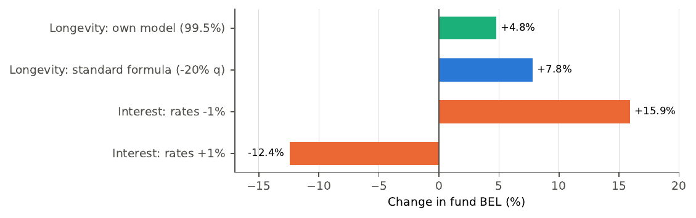
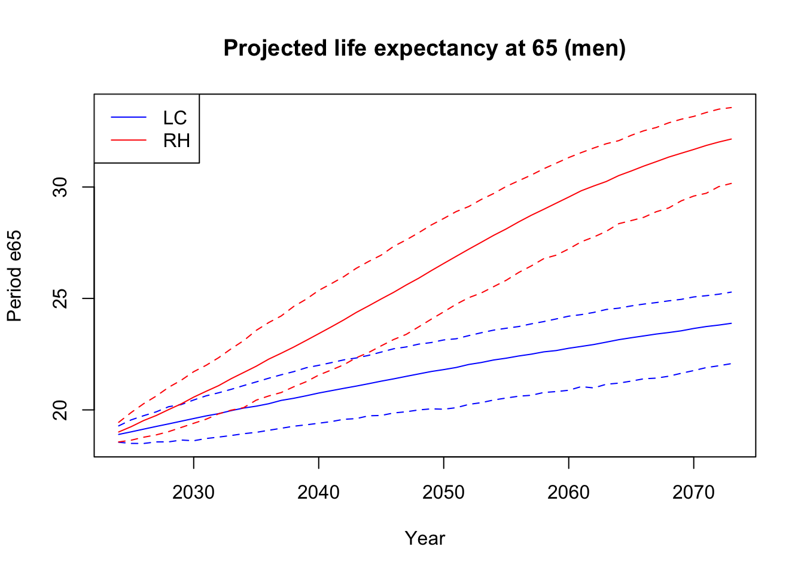

# Longevity risk in a Dutch pension portfolio

How much money does a pension fund need today to pay all the pensions it has promised, and how much
extra does it need for the risk that people live longer than expected or that interest rates fall?

This project answers that question for a synthetic Dutch pension fund of 100,000 participants. It
combines three tools, each used for what it is typically used for in actuarial work:

| Tool | Role |
|---|---|
| **R** | Mortality modelling: Lee-Carter and Renshaw-Haberman models fitted to Dutch data, projected 50 years ahead with 1,000 simulated scenarios |
| **Python** | Liability engine: cash flows, discounting with the EIOPA risk-free curve, best-estimate liability (BEL), stochastic BEL and stress tests |
| **Excel** | Independent rebuild of the calculation for 10 participants, reconciliation with Python, sensitivities and a dashboard |

The full write-up is in **[report/report.pdf](report/report.pdf)**.

## Key results

Valuation date 30 September 2026.

| Result | Value |
|---|---|
| Best-estimate liability (BEL) | EUR 12.3 bn |
| Duration | 14.5 years |
| Longevity risk, own model (99.5% quantile of 1,000 scenarios) | +EUR 583 mln (+4.8% of BEL) |
| Longevity risk, Solvency II standard formula (−20% mortality) | +EUR 959 mln (+7.8%) |
| Interest rates −1% | +EUR 1,953 mln (+15.9%) |
| Interest rates +1% | −EUR 1,528 mln (−12.4%) |



Main findings:

- **The standard formula is more conservative than the model.** The −20% longevity shock costs 7.8% of
  BEL, against 4.8% at the 99.5% level in the Lee-Carter model. Part of that gap is because the model only
  captures the randomness of the mortality trend, not parameter or model risk.
- **Interest rate risk dominates.** A 1% fall in rates costs about twice as much as the longevity shock.
- **The risks sit in different parts of the fund.** Older participants drive longevity risk, younger
  participants drive interest rate risk.
- **The best-fitting model is not the best forecasting model.** Renshaw-Haberman fits the data better
  than Lee-Carter (lower AIC and BIC), but its period and cohort trends offset each other and its
  forecasts drift to implausible life expectancies. Lee-Carter is therefore used for the valuation.



## Method in brief

1. **Mortality (R).** Lee-Carter and Renshaw-Haberman models are fitted with `StMoMo` on Dutch deaths
   and exposures (Human Mortality Database), ages 30–100, years 1990–2023, separately for men and women.
   Lee-Carter is projected to 2073 as a central forecast plus 1,000 simulated scenarios.
2. **Mortality table (Python).** Rates are extrapolated to age 110 and beyond 2073, and converted to
   one-year death probabilities.
3. **Portfolio (Python).** A synthetic fund: 70% actives aged 30–67, 30% retirees aged 68–94, pension
   accrual of 1.75% per year on salary above the AOW franchise, retirement age 68. Only pension accrued
   so far is valued.
4. **Valuation (Python).** Each participant is followed along their generational diagonal. Expected
   pension payments are discounted with the EIOPA euro risk-free curve to give the BEL and duration.
5. **Risk (Python).** The valuation is repeated for all 1,000 mortality scenarios (stochastic BEL), and
   for a −20% longevity shock and ±1% interest rate shifts.
6. **Reconciliation (Excel).** For 10 sample participants, the whole calculation is rebuilt with
   ordinary Excel formulas and named assumptions, and compared with Python. All 10 agree.

## Repository structure

```
├── R/
│   └── Data-cleaning-HMD.Rmd     # mortality models: fit, compare, forecast, export rates
├── python/
│   └── liability_model.py        # portfolio, cash flows, BEL, stochastic BEL, stress tests, Excel export
├── excel/
│   └── longevity_model.xlsx      # rebuild, reconciliation, sensitivities, dashboard (see "Read me" tab)
├── report/
│   ├── report.tex / report.pdf   # full write-up
│   └── figures/
├── data/                         # not in the repo, see below
├── requirements.txt
└── README.md
```

## How to run it

**1. Get the data.** These files are not included in the repository.
- **Mortality:** register at [mortality.org](https://www.mortality.org) and download, for the
  Netherlands, the period data *Deaths* (1x1) and *Exposure-to-risk* (1x1). Save them as
  `data/Deaths_1x1.txt` and `data/Exposures_1x1.txt`.
- **Interest rates:** download the EIOPA risk-free interest rate term structures for 30 September 2026
  from the EIOPA website and unzip them into `data/EIOPA_RFR_20260930/`.

**2. Mortality model (R).** Install `tidyverse`, `StMoMo`, `demography` and `arrow`, set the file paths
in the Rmd to your `data/` folder and knit `R/Data-cleaning-HMD.Rmd`. This writes the central and
simulated mortality rates to `data/`.

**3. Liability model (Python).** From the repository root:
```
python3 -m venv .venv
source .venv/bin/activate
pip install -r requirements.txt
python python/liability_model.py
```
This prints the BEL, stochastic BEL and stress-test results, writes `data/shock_results.csv`, and
exports 10 participants to `excel/python_export.xlsx`.

**4. Excel.** Copy the four data sheets of `python_export.xlsx` (Participants, q_paths, Discount,
CF_python) into `excel/longevity_model.xlsx`. The Reconciliation sheet then shows whether Excel and
Python agree, and the Dashboard summarises the results.

## Limitations and next steps

- Mortality uncertainty covers only the random walk of the Lee-Carter time index, not parameter or model risk.
- Lee-Carter ignores the cohort effects visible in the data. A constrained Renshaw-Haberman model could
  include them with stable forecasts.
- Compare the projection with the Dutch AG2024 projection table, which uses a Li-Lee model with a European trend.
- The ±1% interest rate shift is a simple sensitivity, not the maturity-dependent Solvency II shock, and
  the asset side (hedging) is not modelled.
- The portfolio is synthetic.

## Data sources

- Human Mortality Database. University of California, Berkeley (USA), and Max Planck Institute for
  Demographic Research (Germany). www.mortality.org
- EIOPA, risk-free interest rate term structures, 30 September 2026.

*Author: Daniel Wolff, MSc student Applied Mathematics, TU Delft.*